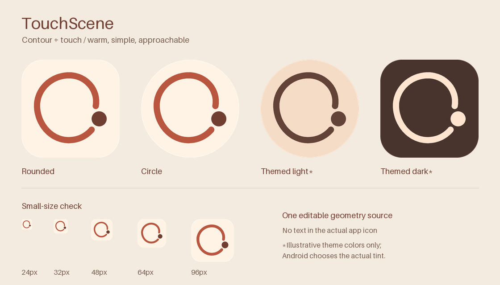

# TouchScene 应用图标

奶油白 `#FFF3E6`、陶土橙 `#B9563F`、深棕 `#713E32`。圆润的开放轮廓与触点表达
主动触摸、探索形状，使用温暖、简约的风格；不是相机、盲文或局部触觉像素的标识。
应用内部主题、名称、包名、算法和交互不因本图标而改变。



## 文件与维护

- `icon-spec.json`：唯一可编辑的几何与配色来源。
- `touchscene-icon.svg`：可在设计软件打开的矢量母版，标准桌面可视区域。
- `touchscene-icon-1024.png`：1024px 平面预览／交接图片，不是 APK 或安装包。
- `preview.png`：裁切和小尺寸检查图；其中主题色是示例，实际由系统选择。
- `../../tools/generate_icons.py`：从同一份定义输出 SVG、Android VectorDrawable 和各尺寸 PNG。

修改 JSON 后重新生成；不要只修改 SVG、XML 或其中一张 PNG，以免各种桌面显示不一致。
PNG 采用固定曲线采样和超采样；Android 使用同一曲线的原生矢量路径。
矢量与 PNG 的边缘抗锯齿由各自渲染器实现，不保证逐像素一致。

从仓库根目录运行（Python 3.10+）：

```sh
python -m pip install -r tools/requirements-icons.txt
python tools/generate_icons.py
python tools/generate_icons.py --check
node --test tests/app-icon.test.mjs
```

Pillow 仅为维护工具依赖，不进入 Android APK。`--check` 不写文件，检查全部 18 个输出：
XML／SVG 文本与 PNG 解码像素；PNG 压缩字节不同不影响检查。
生成操作只会移除五个密度目录中已废弃的 `ic_launcher.webp`／`ic_launcher_round.webp`，
共十个旧图标，其他文件不删除。

## Android 适配

- 保持 Manifest 的 `@mipmap/ic_launcher` 与 `@mipmap/ic_launcher_round` 引用。
- 自适应画布 108×108dp，前景透明、背景铺满；核心笔画与触点位于中央 66dp 安全区内。
- 前景和单色层几何一致；单色层不含实心背景，系统可应用主题色。
- 传统图标：mdpi／hdpi／xhdpi／xxhdpi／xxxhdpi 分别为 48／72／96／144／192px，
  普通版圆角、圆形版透明外角；自适应图层不预先裁圆。
- SVG／1024px 预览使用中央 72dp 可视区域，不应直接拿它替换 108dp 自适应前景。

参考 [Android 自适应图标规范](https://developer.android.com/develop/ui/compose/system/icon_design_adaptive)。
原始几何为本项目新绘制，无外部图标、字体或素材文件；本次未为整个项目新增开源授权。

## 本轮验证

资源、构建、源码保护和发布检查的最新结果见 [图标验证记录](VALIDATION.md)。
本轮不安装手机、不重新运行真机感知验收；历史算法／振感证据仍以原验收记录为准。
